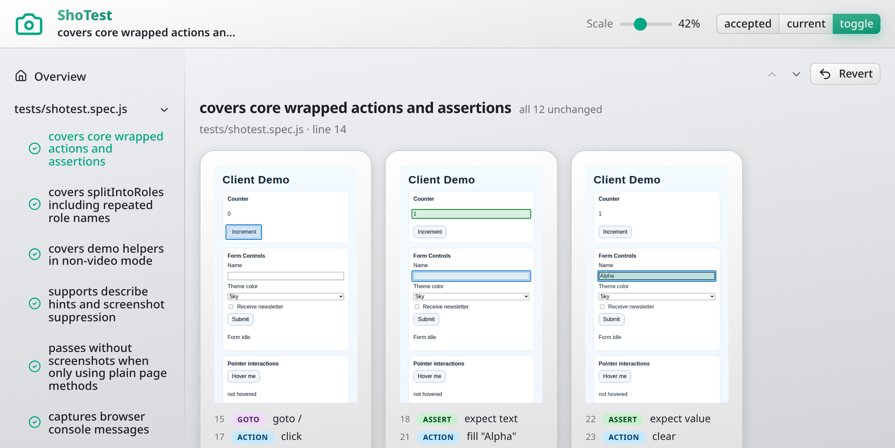

# ShoTest

**ShoTest 3 is here** 🎉 — a review is now applied in one go, with comments on screenshots for whoever makes the next round of changes (an AI agent, say), and tests that already passed on an unchanged source tree are skipped.

ShoTest is a small wrapper around Playwright Test that acts as a drop-in replacement and provides:

- Automatic screenshots at every step of your test, with the actions taken and elements verified logged as events alongside each screenshot.
- A local web app for browsing test results, comparing changes against the stored baseline, accepting intentional changes and commenting on the others.
- Deterministic rendering: tests run in the official Playwright container image by default, so screenshot comparison can be exact.
- HTML snapshots at every step, for debugging (by coding agents).
- Helpers for recording demo videos with visible interactions and natural delays.



## Setup

Install `shotest` (*instead* of installing `@playwright/test` directly) and install a browser:

```bash
npm install -D shotest
npx shotest install chromium
```

Create a `tests/` directory, in which your tests will live as `.spec.ts` files.

Add the `test-results` directory to `.gitignore`.

Create a `playwright.config.ts`, that may look something like this:

```ts
import { defineConfig } from 'shotest';

export default defineConfig({
  use: {
    baseURL: 'https://automationexercise.com/', // set to your app URL
    screenshot: 'off', // ShoTest captures its own screenshots
    viewport: { width: 450, height: 800 },
  },
  timeout: 5000, // ms before a test fails
  workers: 1, // set this if your app has state
  webServer: [ // start your test-servers here (optional)
    // { 
    //   command: 'exec npm run dev -- --port 25833',
    //   port: 25833,
    // },
  ]
});
```

If you use Claude Code, GitHub Copilot or another AI agent that supports Skills, the npm package includes a `skill/` directory with these docs, for in-context guidance while writing tests. To set it up:

```bash
mkdir -p .claude/skills
ln -s ../../node_modules/shotest/skill .claude/skills/shotest
```

## Basic usage

ShoTest re-exports the full Playwright Test API, which you can use like normal. For example:

```ts
// tests/example.spec.ts
import { test } from 'shotest';

test('view and buy a product', async ({ page }) => {
    await page.goto('/');

    await page
        .locator('.product-image-wrapper', { hasText: 'Fancy Green Top' })
        .getByRole('link', { name: 'View Product' })
        .click();

    await page.getByRole('heading', { name: 'Fancy Green Top' }).waitFor();
    await page.getByRole('button', { name: /add to cart/i }).click();
    await page.getByRole('link', { name: /view cart/i }).click();
});
```

Most common page and locator actions are wrapped so that a screenshot is taken automatically during the test. Run the tests using:

```sh
npx shotest test
```

This writes results to `test-results/`: one JSON file per test, plus the screenshots and HTML snapshots, named by a hash of their pixel content (so identical frames share a single file). What happened at each moment — clicks, assertions, navigations — is recorded as *events* in the JSON, each with a message, source line and the viewport box of the element involved. Steps that don't change the page share a single screenshot carrying the whole list of events.

An uncaught exception in the page fails the test, once it has run to its end, with the first such error as its message. Set the `failOnPageError` test option to `'console'` to fail on `console.error` output as well, or to `false` to only record errors as events.

The `shotest` command forwards arguments to Playwright, so `npx shotest test --ui` maps to `playwright test --ui`.

### Skipping unchanged tests

A test that passed looking exactly like its accepted baseline is recorded as such for the source tree it ran on: `test-accepted/<tree-hash>.passed` lists those tests. The tree hash covers every file git would see — uncommitted and untracked ones included, ignored ones not — except `test-results/` and `test-accepted/`. When `npx shotest test` runs on a tree whose stamp lists a test, it skips that test, recording the baseline's steps as its result. Change any file and everything runs again; `npx shotest test --all` (or `SHOTEST_RUN_ALL=1`) runs everything regardless. Outside a git work tree nothing is skipped.

Only the current tree's stamp is kept, and since its name is the tree's hash, branches never write the same stamp, so merging them does not conflict on it.

A test run writes a new stamp whenever its tree has none yet. Where a check must leave the work tree as it found it (a merge gate, say), add `test-accepted/*.passed` to `.gitignore`: skipping then only spans runs on one machine.

`npx shotest collect` summarizes the results on disk (failed tests and visual changes), cleans up unreferenced files, and exits with 0 (all good), 1 (failed tests) or 2 (tests passed, but visual changes await review) — use it after a test run, e.g. to gate CI on visual consistency.

## Deterministic screenshots

Screenshot comparison is exact: two steps match only when their pixel hashes do, with no tolerance threshold. What makes that workable is a pinned rendering environment — rendering is a function of the browser build plus the OS font stack — so by default `npx shotest test` runs Playwright inside the official Playwright image matching your installed version, using `podman` or `docker` (in that order), with your project mounted at its real path. Results land in `test-results/` as usual. (ShoTest also launches Chromium with the determinism flags its own pixel tests use — including `--disable-lcd-text`, since subpixel text anti-aliasing varies with compositor state, and `--disable-gpu`, since even without a GPU device Chromium routes raster through its GPU process, whose under-load fallbacks change pixels — so output is stable across runs, load levels and same-architecture machines.)

Timing is pinned as well: transitions and animations are fast-forwarded to their end the moment they start (so tests never wait on them, while `transitionend`/`animationend` still fire and apps clean up as usual), and every capture additionally waits for DOM mutations, new animations and scrolling to go quiet. Captures therefore land on settled page states instead of racing the app's own rendering, animations and cleanup. Actions settle the same way before they run, so where a click lands (and whether it needs to scroll first) is decided on a page at rest. The mouse stays where the last click (or hover) left it, keeping its `:hover` styling, until the page changes under it: once the clicked element's parent is gone or covered (a page change, a modal), the mouse is moved off the page, so no hover lands on an element nobody pointed at.

A page that never goes quiet within the settle cap (500ms) — an effect rewriting an element's style on every animation frame, a scroll loop, a busy marker that never clears — fails the test at that capture, with a message naming what was last seen moving (`the DOM kept mutating (last: attribute "style" on div.glow)`). A frame of such a page is a matter of timing and can never match a baseline, so the failure points at the cause instead of showing up as random flakiness later; the step is still recorded, with the error, for the review app. Fix the cause (stop the effect under test, or mark it busy — see below), or wrap that part in `suppressScreenshots()`: nothing is captured there, so nothing fails, and an explicit `screenshot(page, name)` inside it captures anyway and is merely flagged *unstable* in the review app.

Some frames can never be still without any DOM ever changing: an animated GIF or WebP (which `getAnimations()` does not cover, and nothing pauses), a playing video, a canvas drawn every frame. To find them all in one run instead of after several, set `SHOTEST_DETECT_UNSTABLE=1` (or the `detectUnstable` test option): every frame is then captured twice, 150ms apart, and a difference fails the test the same way, with the changed area outlined on the screenshot. A number instead of `1` sets the interval in milliseconds. The only fix for such a frame is to stop capturing it, so leave this off in regular runs — it doubles the capture work.

When several changes arrive in an undefined order — two websocket pushes, another browser in the same test — the screenshots between their awaits depend on timing. Await them inside a `suppressScreenshots()` block (see below) instead; the step after it shows the settled result.

When the app knows something is on its way that hasn't rendered yet, mark such busy states ("… is typing", a pending photo swap) with classes of your own and name them in the `busySelector` test option — `use: { busySelector: '.test_typing' }` in the config, or `test.use()` per file. Captures wait while it matches.

The container part is handled by `shotest-playwright`, a plain shell script also installed as a command: it runs the Playwright CLI in the pinned image, falling back to a native run. You can invoke it directly in dev environments that have no Node.js — node only has to exist inside the image — and follow up with `npx shotest collect` elsewhere (e.g. CI) for the summary and exit code.

- Pass `--no-container` (or set `SHOTEST_NO_CONTAINER=1`) to run natively. That is the CI pattern: make the Playwright image the job's own image (GitHub Actions: `container: mcr.microsoft.com/playwright:v1.59.1-noble` on the job) and run `npx shotest test --no-container`. A machine with no container runner gets a warning and a native run.
- Set `SHOTEST_IMAGE` to override the image, e.g. to pin a digest for byte-for-byte reproducibility.

A Playwright upgrade means a browser upgrade, which typically means re-accepting baselines once. Two caveats: baselines are only comparable when everyone (developers and CI) generates them from the same image on the same CPU architecture, and the bind-mounted `node_modules` must be loadable inside the Linux container — true on Linux hosts, but macOS/Windows hosts install their own platform's native modules, so there prefer a devcontainer, or let CI produce `test-results/` and review that.

## Step descriptions and skipping screenshots

Attach a one-line hint to what happens next; the review tool shows it as a header above the events that follow it:

```ts
page.describe('Create lunch talk event');
await page.getByRole('button', { name: 'New event' }).click();
```

Routine flows that reoccur in many tests (logging in, seeding data) would otherwise produce countless screenshots. Wrap them in `suppressScreenshots(description, fn)` to skip capture — the review tool shows a placeholder with your description instead, and the wrapped part runs faster too:

```ts
import { test, suppressScreenshots } from 'shotest';

test('create event', async ({ page }) => {
  await suppressScreenshots('Log in as admin', async () => {
    await page.goto('/login');
    await page.getByLabel('Email').fill('admin@example.com');
    await page.getByRole('button', { name: 'Log in' }).click();
  });
  // ...the part this test is actually about, with screenshots as usual
});
```

`forceScreenshots(fn)` does the opposite: inside it screenshots are always captured, overriding `suppressScreenshots` blocks around it and within it alike. Typical use: wrapping a call to a helper that suppresses its own screenshots, in the one test where that routine flow is the actual functionality under test. A failure inside a suppressed block still captures an error screenshot, and explicit `screenshot(page, name)` calls always capture.

## Reviewing and accepting visual changes

To review test results, compare changes against the baseline, and accept intentional changes:

```bash
npx shotest review
```

This serves a web app on localhost and opens it in your default browser.

Each screenshot is shown with its list of recorded events right beneath it, color-coded by type and prefixed with source line — browser console output included. Hovering an event (or tapping it, to pin it) outlines the viewport area it involved on the image. When a step changed, the accepted and current versions are cross-faded, each with its own event list, and buttons on the step's status tag pin either side or show the changed pixels as an amplified diff. An unchanged step shows the current run's events only.

For each test with changes, either press 'Accept' (or `a`) to take its new screenshots as the baseline, or leave comments on the screenshots that are not right. A test you leave alone stays undecided. Nothing is written until you press 'Apply' in the top bar; 'Discard' drops the whole review instead. Applying accepts the marked tests: their screenshots are copied into `test-accepted/` (configurable through `SHOTEST_ACCEPTED_DIR`) and become the new baseline. Commit this directory to version control (unlike `test-results/`). To keep it small, accepted images are recompressed to lossless WebP — starting as soon as a test is marked accepted, so applying has little left to wait for; hashes are computed from pixels, not file bytes, so names don't change.

Comments are stored in `test-accepted/` too (as `<test>.comments.json`), so they reach whoever works on the next round, in whichever checkout. They stay until the test is accepted (which asks first) or they are removed one by one. A later run puts each comment on the step showing the same screenshot, or else on the step with the same actions and checks; comments on screenshots a run no longer has are shown above the test's steps.

Baselines for tests that produced no results at all are listed separately at the bottom, under *not in test-results/*. Usually their test was renamed or deleted and the baseline should go — but the same thing happens when a test simply didn't run (e.g. a filtered run), so ShoTest never removes one on its own. Selecting such an entry shows what would be deleted, and 'Delete baseline' marks it for deletion.

### Waiting for the reviewer

`npx shotest review` ends once the review is applied or discarded — or right away, when there are no changes and no comments to look at. It then prints every test whose changes were not accepted or that has comments, with each comment, the step it is on and the paths of that step's screenshots, and exits with 0 when nothing is left (1 otherwise). Waiting for the command is thus waiting for a human's verdict, which is how an AI agent can hand its visual changes over and pick up the comments.

## Garbage collection

`npx shotest gc` deletes pool images (and HTML snapshots) in `test-results/` and `test-accepted/` that are no longer referenced by any of the JSON files there. You'll rarely need it: `test-results/` is cleaned by every `npx shotest collect`, and `test-accepted/` whenever a review is applied.

## Multi-user tests

ShoTest can label screenshots per browser page, which makes multi-user interaction tests practical to script and review. Call `splitIntoRoles(page, ...)` before the first interaction you want attributed to a role: it repurposes the current `page` for the first role and creates additional labeled browser sessions for the later roles, opened on the same URL.

```ts
import { test, expect, splitIntoRoles } from 'shotest';

test('buyer sees seller status update', async ({ page }) => {
  await page.goto('/orders');

  const { seller, buyer } = await splitIntoRoles(page, 'seller', 'buyer');

  await seller.getByRole('button', { name: 'Mark as shipped' }).click();
  await buyer.getByText('Shipped').waitFor();

  await expect(buyer.getByText('Shipped')).toBeVisible();
});
```

Repeating a role name within a test returns the same page instead of creating a duplicate session. In the review app, each role's screenshots throw a drop shadow in that role's colour, so the browser windows are easy to tell apart. Extra pages are closed automatically at the end of the test.

## Recording demo videos

ShoTest includes helper functions for recording demonstration videos with visible interactions and natural delays:

- `demoTap(page, locator, delayMs?)` — tap with a visible touch ripple.
- `demoType(page, locator, text, charDelayMs?)` — type character-by-character with natural timing.
- `demoPause(page, ms?)` — pause so viewers can take in the current state.
- `demoSwipe(page, locator, direction, distancePx?)` — swipe (`'up' | 'down' | 'left' | 'right'`) with a visible touch indicator.

```ts
import { test, expect, demoTap, demoType, demoPause } from 'shotest';

test('demo', async ({ page }) => {
  await page.goto('http://localhost:3000');
  await demoTap(page, page.getByRole('button', { name: 'Open settings' }));
  await demoType(page, page.getByLabel('Name'), 'Living room');
  await demoPause(page, 1200);
});
```

These helpers only apply their delays and touch effects when *demo mode* is active; otherwise they run as fast as possible, so demo scripts can be part of your regular test suite without an outsized impact on runtime. Demo mode activates automatically when Playwright video recording is enabled or when running headed; override it by setting `SHOTEST_DEMO` to `on` or `off`.

A convenient way to record demo videos for a run:

```sh
SHOTEST_VIDEO=on npx shotest test
```

This uses Playwright's normal video output handling, so the videos are written to the standard per-test output directory under `test-results/`.

## Environment variables

For test recording:

- `SHOTEST_CAPTURE_HTML`: Set to `false` to skip capturing DOM HTML alongside screenshots (captured by default)
- `SHOTEST_DETECT_UNSTABLE`: Capture every frame twice and fail on frames that differ from themselves (see *Deterministic screenshots*). `1` uses a 150ms interval, a number sets it in milliseconds.
- `SHOTEST_VIDEO`: Enables Playwright video recording for the run. Set it to `on`, `retain-on-failure`, or `on-first-retry`; set it to `off` to disable it.
- `SHOTEST_DEMO`: Whether the demo helper functions emulate user behavior (`on` or `off`, defaults to auto-detecting video recording or headed mode)
- `SHOTEST_NO_CONTAINER`: Set to `1` to run tests natively instead of in the Playwright container
- `SHOTEST_RUN_ALL`: Set to `1` to run tests that already passed on the current source tree too (like `--all`)
- `SHOTEST_IMAGE`: Container image to run tests in (defaults to the Playwright image matching your installed version)

For the review server:

- `SHOTEST_OUTPUT_DIR`: Where to read test results (defaults to `test-results`)
- `SHOTEST_ACCEPTED_DIR`: Where to store accepted baseline images (defaults to `test-accepted`)
- `SHOTEST_PORT`: Preferred web server TCP port (defaults to `3847`; if unavailable, ShoTest tries the next 9 ports)
